# git-cli

`git-cli` is a standalone Go command-line tool for Git repository maintenance, secret scanning, application-aware pre-commit checks, `.gitignore` management, encrypted PAT storage, repository diagnostics, and GitHub Actions workflow-run management.

**Current version: 0.9.0**

## Contents

- [Installation](#installation)
- [Global commands](#global-commands)
- [Security](#security)
- [Pre-commit](#pre-commit)
- [Gitignore](#gitignore)
- [Project inspection](#project-inspection)
- [Repository health](#repository-health)
- [Cleanup](#cleanup)
- [Large files](#large-files)
- [Branch inspection](#branch-inspection)
- [PAT management](#pat-management)
- [GitHub Actions](#github-actions)
- [Doctor](#doctor)
- [Hook dispatcher](#hook-dispatcher)
- [Justfile](#justfile)
- [update-cli integration](#update-cli-integration)
- [Exit codes](#exit-codes)

## Installation

Build and install from source:

```bash
just check
just build
sudo just install
```

Default installation path:

```text
/usr/local/bin/git-cli
```

Verify:

```bash
git-cli --version
git-cli help
```

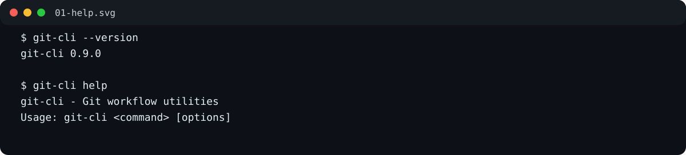

## Global commands

| Command | Purpose |
|---|---|
| `git-cli help`, `--help`, `-h` | Show top-level help |
| `git-cli version`, `--version`, `-v` | Show embedded binary version |
| `git-cli doctor` | Diagnose repository/tooling setup |
| `git-cli hook run pre-commit` | Internal hook dispatcher |

Top-level command groups:

| Group | Purpose |
|---|---|
| `security` | Secret scanning and security hook management |
| `precommit` | Application-aware staged-code checks |
| `gitignore` | Create, inspect and maintain `.gitignore` |
| `project` | Detect application type |
| `repo` | Repository health |
| `clean` | Safe cleanup |
| `large-files` | Detect oversized tracked files |
| `branch` | Inspect merged/stale local branches |
| `pat` | Encrypted local GitHub PAT storage |
| `actions` | GitHub Actions workflow-run management |

---

## Security

Security integrates Gitleaks, detect-secrets and optional TruffleHog.

### Commands

| Command | Parameters | Description |
|---|---|---|
| `security install` | none | Install managed security pre-commit hook |
| `security uninstall` | none | Remove managed security hook |
| `security status` | none | Show security configuration |
| `security check-staged` | `--json`, `--timeout DURATION` | Scan staged changes |
| `security check` | `--json`, `--timeout DURATION` | Scan repository |
| `security check --deep` | `--json`, `--timeout DURATION` | Deep scan using supported deep scanner |
| `security check-history` | `--json`, `--timeout DURATION` | Scan Git history |
| `security scanner list` | none | List scanners and supported modes |
| `security scanner status` | none | Show enabled/required/installed state |

### Parameters

| Parameter | Default | Meaning |
|---|---:|---|
| `--json` | false | Emit machine-readable JSON |
| `--timeout` | `2m` | Maximum scan duration |
| `--deep` | false | Select deep repository scan mode |

Examples:

```bash
git-cli security install
git-cli security status
git-cli security check-staged
git-cli security check --json
git-cli security check --timeout 5m
git-cli security check --deep
git-cli security check-history
git-cli security scanner list
git-cli security scanner status
git-cli security uninstall
```

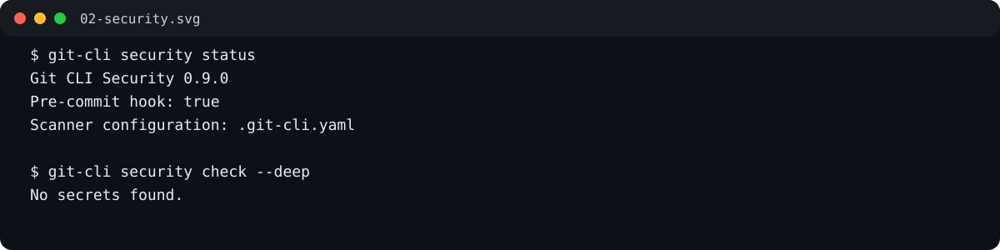

---

## Pre-commit

Application-aware pre-commit checks are configured separately from secret scanning. The generated hook dispatches security checks first, then application-specific checks.

### Supported presets

```text
python
fastapi
django
laravel
```

### Commands and parameters

| Command | Parameters | Description |
|---|---|---|
| `precommit --setup --for PRESET` | `--setup`, `--for` | Install configuration for explicit preset |
| `precommit --setup --scan` | `--setup`, `--scan` | Auto-detect preset |
| `precommit run` | none | Run configured staged checks |
| `precommit status` | none | Show hook/config status |
| `precommit list` | none | List supported presets |
| `precommit uninstall` | none | Remove application checks while retaining security scanning |

`--for` and `--scan` are mutually exclusive.

Examples:

```bash
git-cli precommit --setup --for python
git-cli precommit --setup --for fastapi
git-cli precommit --setup --for django
git-cli precommit --setup --for laravel
git-cli precommit --setup --scan
git-cli precommit run
git-cli precommit status
git-cli precommit list
git-cli precommit uninstall
```

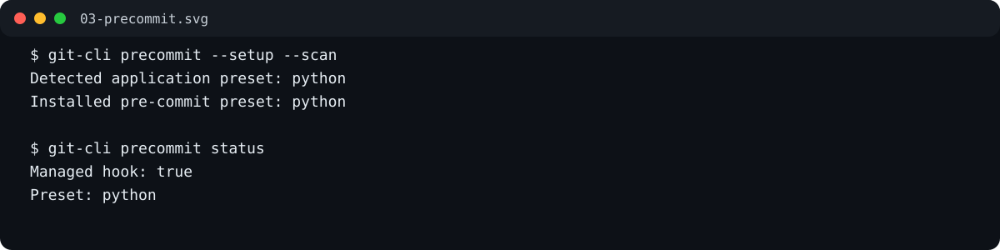

---

## Gitignore

`git-cli gitignore` preserves hand-written rules and manages only marked sections.

Managed blocks use this form:

```text
# >>> git-cli gitignore: django
...
# <<< git-cli gitignore: django
```

### Presets

Built-in preset names currently include:

```text
python fastapi django go node javascript typescript react
nextjs vue nuxt laravel
```

### Commands and parameters

| Command | Parameters | Description |
|---|---|---|
| `gitignore add` / `create` | `--for PRESET` | Add/refresh managed preset block |
| `gitignore add` / `create` | `--template TEMPLATE` | Add GitHub gitignore template |
| `gitignore add` / `create` | `--scan` | Detect project and add preset |
| `gitignore list` | `--filter TERM` | List GitHub templates, optionally filtered |
| `gitignore presets` | none | List built-in presets |
| `gitignore show` | `--for PRESET` | Preview managed preset |
| `gitignore show` | `--template TEMPLATE` | Preview template |
| `gitignore download` | `--template TEMPLATE`, `--output FILE` | Download raw template |
| `gitignore status` | none | Show managed sections |
| `gitignore remove` | `--for PRESET` or `--template TEMPLATE` | Remove managed block |
| `gitignore explain` | `PATH [PATH...]` | Explain matching ignore rule |
| `gitignore tracked` | none | Show tracked files that match ignore rules |

Examples:

```bash
git-cli gitignore add --for django
git-cli gitignore add --scan
git-cli gitignore add --template Python
git-cli gitignore add --template Global/macOS
git-cli gitignore list
git-cli gitignore list --filter python
git-cli gitignore presets
git-cli gitignore show --for django
git-cli gitignore show --template Python
git-cli gitignore download --template Python
git-cli gitignore download --template Global/macOS --output macOS.gitignore
git-cli gitignore status
git-cli gitignore remove --for django
git-cli gitignore explain .env
git-cli gitignore explain .env dist/output.json
git-cli gitignore tracked
```

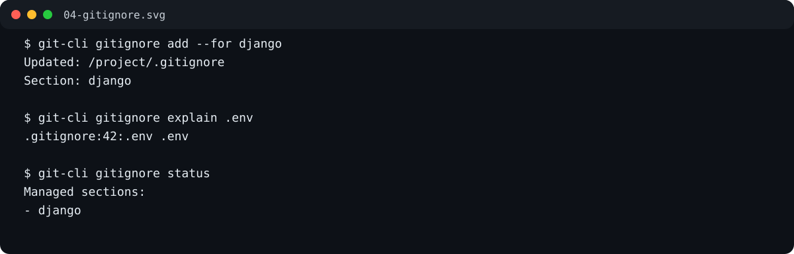

---

## Project inspection

### Commands

| Command | Parameters | Description |
|---|---|---|
| `project detect` | `--json` | Detect application/project type |
| `project info` | `--json` | Show richer project information |

Examples:

```bash
git-cli project detect
git-cli project detect --json
git-cli project info
git-cli project info --json
```

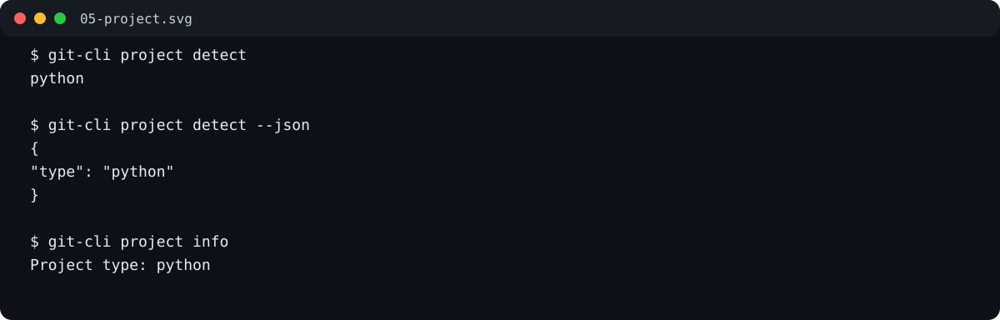

---

## Repository health

```bash
git-cli repo health
```

Checks include:

- current branch
- dirty/clean working tree
- upstream configuration
- ahead/behind counts
- `.gitignore` presence
- tracked files now matching ignore rules

Example:

```bash
git-cli repo health
```

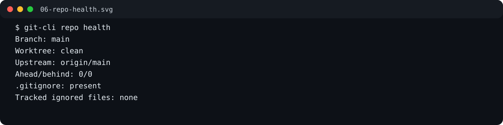

---

## Cleanup

Cleanup commands map to Git's safe preview/apply modes.

| Command | Description |
|---|---|
| `clean preview` | Preview untracked files: equivalent to `git clean -nd` |
| `clean ignored --preview` | Preview ignored files: equivalent to `git clean -ndX` |
| `clean ignored --apply` | Delete ignored files/directories: equivalent to `git clean -fdX` |

Examples:

```bash
git-cli clean preview
git-cli clean ignored --preview
git-cli clean ignored --apply
```

`--apply` is intentionally required for destructive ignored-file cleanup.

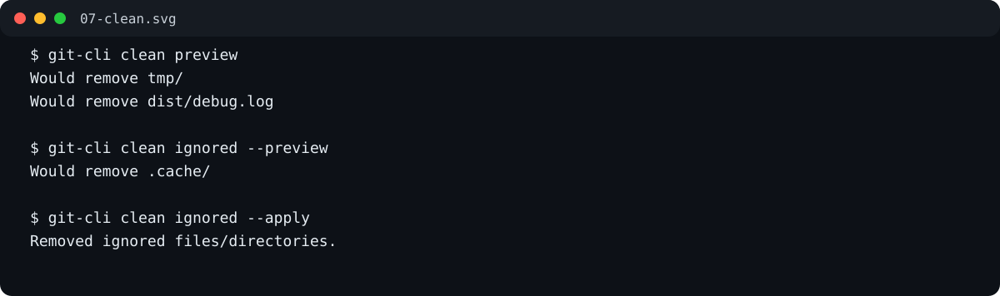

---

## Large files

### Syntax

```bash
git-cli large-files scan [--threshold-mb MB]
```

| Parameter | Default | Description |
|---|---:|---|
| `--threshold-mb` | `25` | Minimum tracked blob size to report |

Examples:

```bash
git-cli large-files scan
git-cli large-files scan --threshold-mb 50
git-cli large-files scan --threshold-mb 100
```

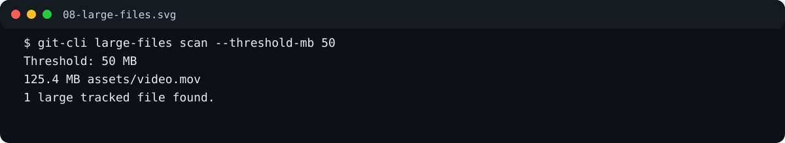

---

## Branch inspection

These commands are read-only.

| Command | Description |
|---|---|
| `branch merged` | List local branches already merged into current HEAD |
| `branch stale` | List local branches ordered by commit date |

Examples:

```bash
git-cli branch merged
git-cli branch stale
```

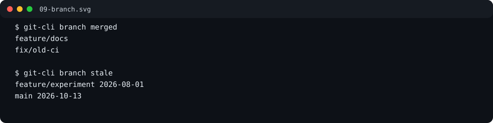

---

## PAT management

PATs are stored locally and encrypted at rest with AES-256-GCM.

For an installation at:

```text
/usr/local/bin/git-cli
```

the files are:

```text
/usr/local/etc/git-config/pat.yaml
/usr/local/etc/git-config/pat.key
```

Permissions:

```text
/usr/local/etc/git-config   0700
pat.yaml                    0600
pat.key                     0600
```

Override the config directory with:

```bash
export GIT_CLI_CONFIG_DIR=/custom/config
```

### Commands and parameters

| Command | Parameters | Description |
|---|---|---|
| `pat create` | `--name NAME --token TOKEN` | Store/update token |
| `pat create` | `--name NAME --token-stdin` | Read token from stdin; preferred |
| `pat display` | positional `NAME` or `--name NAME` | Decrypt and print token |
| `pat list` | none | List stored PAT names |
| `pat delete` | positional `NAME` or `--name NAME` | Delete token |
| `pat status` | none | Show file paths, modes and encryption status |
| `pat secure` | none | Migrate plaintext v0.7.2 entries to encrypted format |

Examples:

```bash
git-cli pat create --name git-cli --token github_pat_xxx
printf '%s' "$GITHUB_TOKEN" | git-cli pat create --name git-cli --token-stdin
git-cli pat display git-cli
git-cli pat display --name git-cli
git-cli pat list
git-cli pat status
git-cli pat secure
git-cli pat delete git-cli
git-cli pat delete --name git-cli
```

Prefer `--token-stdin`: command-line token values can appear in shell history or process listings.

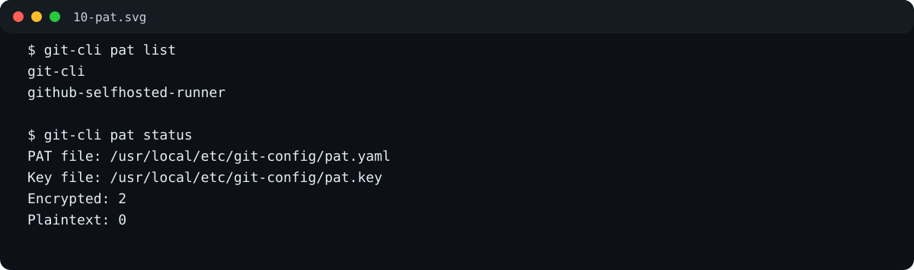

---

## GitHub Actions

### List workflow runs

Syntax:

```bash
git-cli actions list   --repository OWNER/REPO   [--state STATE]   [--verbose]   [--details]   [--pat NAME]
```

### Delete workflow runs

Syntax:

```bash
git-cli actions delete   --repository OWNER/REPO   --state STATE   [--verbose]   [--details]   [--pat NAME]
```

`delete` requires `--state`; unfiltered bulk deletion is intentionally rejected.

### Parameters

| Parameter | Required | Description |
|---|---|---|
| `--repository OWNER/REPO` | yes | Repository, e.g. `r14r/git-cli` |
| `--repository URL` | yes | GitHub URL is also accepted |
| `--state STATE` | list: no; delete: yes | Filter by GitHub workflow-run status/conclusion |
| `--verbose` | no | Show only workflow name and effective state |
| `--details` | no | Show full run details and authentication source |
| `--pat NAME` | no | Explicit encrypted PAT name; overrides `GITHUB_TOKEN` |

### Supported states

```text
completed
action_required
cancelled
failure
neutral
skipped
stale
success
timed_out
in_progress
queued
requested
waiting
pending
```

### Authentication order

1. explicit `--pat NAME`
2. `GITHUB_TOKEN`
3. automatically use the stored PAT when exactly one exists
4. anonymous access for public repositories

Private repositories require a fine-grained PAT with **Actions: read** for listing. Deleting runs requires **Actions: write**.

### Standard list examples

```bash
git-cli actions list --repository r14r/Templates_Docker-Compose
git-cli actions list --repository https://github.com/r14r/Templates_Docker-Compose
git-cli actions list --repository r14r/Templates_Docker-Compose --state failure
git-cli actions list --repository r14r/Templates_Docker-Compose --pat git-cli
```

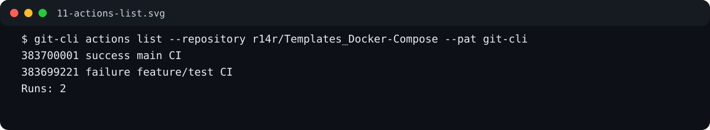

### Verbose output

`--verbose` intentionally shows only workflow name and state:

```bash
git-cli actions list   --repository r14r/Templates_Docker-Compose   --verbose   --pat git-cli
```

Representative output:

```text
CI              success
Release         failure
Security Scan   success
Runs: 3
```

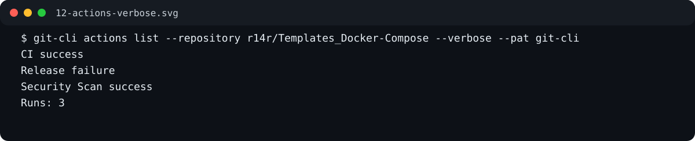

### Detailed output

`--details` shows repository/authentication plus all available run metadata:

```bash
git-cli actions list   --repository r14r/Templates_Docker-Compose   --details   --pat git-cli
```

Fields include:

- repository
- authentication source
- run ID
- workflow/title
- state/status/conclusion
- branch
- event
- commit SHA
- run number and attempt
- actor
- created/updated timestamps
- GitHub URL

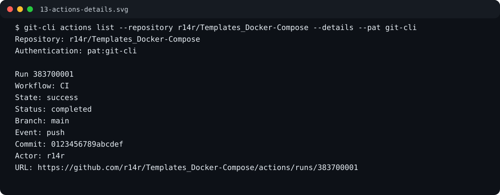

### Delete examples

```bash
git-cli actions delete   --repository r14r/Templates_Docker-Compose   --state failure   --pat git-cli

git-cli actions delete   --repository r14r/Templates_Docker-Compose   --state cancelled   --verbose   --pat git-cli

git-cli actions delete   --repository r14r/Templates_Docker-Compose   --state timed_out   --details   --pat git-cli
```

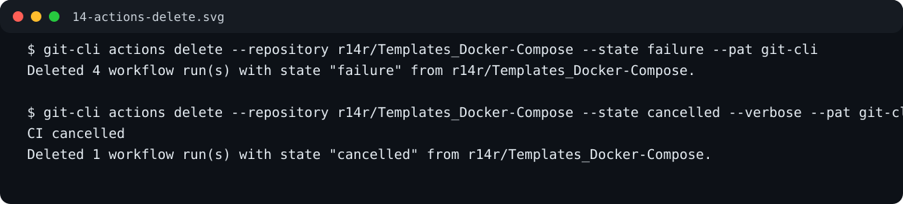

---

## Doctor

```bash
git-cli doctor
```

Doctor diagnoses:

- Git repository access
- hooks
- configured scanners
- scanner availability
- security configuration
- detected application preset
- required runtimes/tooling

Example:

```bash
git-cli doctor
```

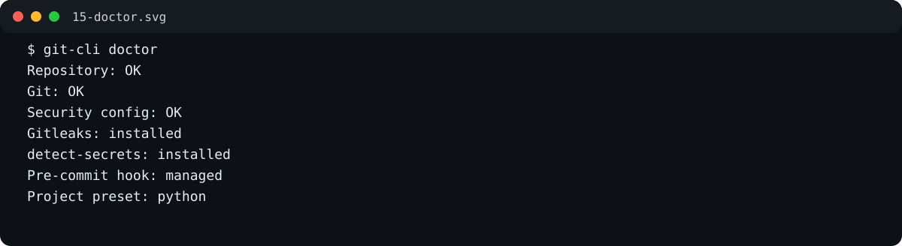

---

## Hook dispatcher

The generated application-aware pre-commit hook calls:

```bash
git-cli hook run pre-commit
```

Execution order:

1. `git-cli security check-staged`
2. `git-cli precommit run`

This command is normally invoked by Git rather than manually.

---

## Justfile

Running `just` without arguments displays the recipe help:

```bash
just
```

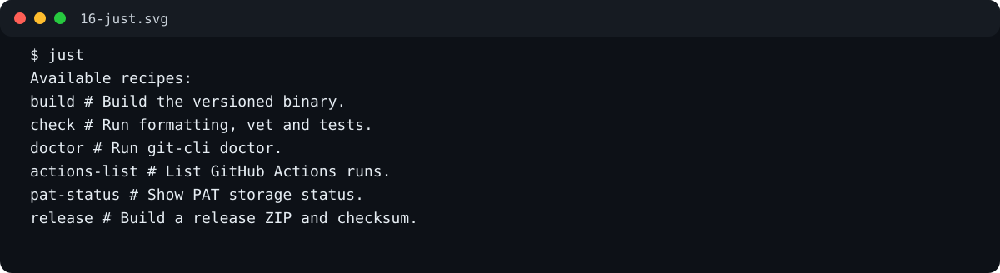

### Build and development

| Recipe | Description |
|---|---|
| `just version` | Show project version/install target |
| `just check-tools` | Verify Go, Git, Just |
| `just fmt` | Format source |
| `just fmt-check` | Check formatting without modification |
| `just vet` | Run `go vet` |
| `just test` | Run tests |
| `just test-v` | Verbose tests |
| `just test-race` | Race-enabled tests |
| `just check` | Formatting + vet + tests |
| `just build` | Build versioned binary |
| `just install` | Build and install |
| `just reinstall` | Clean build artifacts then install |
| `just run ARGS...` | Run from source |
| `just exec ARGS...` | Build then run binary |
| `just cli-help` | Show CLI help |

### Diagnostics and Git

```text
doctor
repo-health
project-detect
project-info
git-status
git-log
git-branches
git-fetch
git-pull
diff
diff-staged
```

### PAT

```bash
just pat-list
just pat-status
just pat-secure
just pat-display git-cli
just pat-delete git-cli
```

### Gitignore

```bash
just gitignore-status
just gitignore-presets
just gitignore-list
just gitignore-scan
just gitignore-explain .env
just gitignore-tracked
```

### Security and pre-commit

```bash
just precommit-run
just precommit-status
just precommit-list
just security-status
just security-staged
just security-check
just security-deep
just security-history
```

### Cleanup, files and branches

```bash
just clean-preview
just clean-ignored-preview
just clean-ignored-apply
just large-files
just large-files-mb 50
just branch-merged
just branch-stale
```

### GitHub Actions

```bash
just actions-list
just actions-state failure
just actions-verbose
just actions-state-verbose failure
just actions-delete failure
just actions-delete-verbose cancelled
```

### Release

```bash
just clean
just clean-build
just release
just release-list
```

---

## update-cli integration

The repository contains `update-cli.yaml`.

Initialize:

```bash
update-cli init git-cli   --from repository   --repository https://github.com/r14r/git-cli.git
```

Run setup:

```bash
update-cli setup
git-cli --version
```

The setup workflow:

1. downloads Go modules
2. runs vet
3. runs tests
4. reads `VERSION`
5. builds with `-X main.version=<VERSION>`
6. verifies `dist/git-cli --version` equals `VERSION`
7. installs to `/usr/local/bin/git-cli`

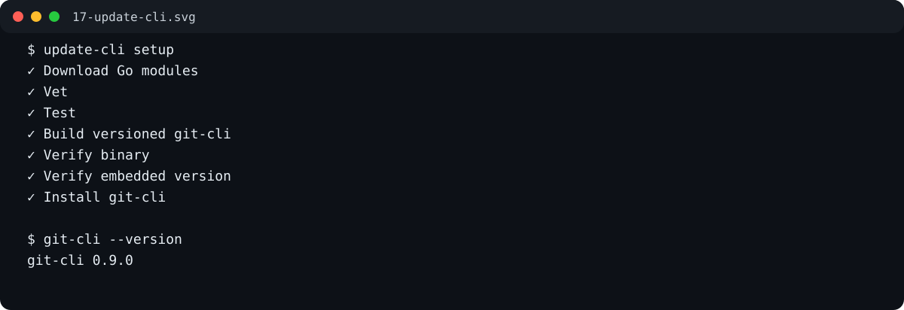

---

## Exit codes

| Code | Meaning |
|---:|---|
| `0` | Success / no finding |
| `1` | Finding or actionable repository issue |
| `2` | Usage, configuration, dependency or runtime error |

Some security commands return `1` when findings are detected so they can block commits or CI.

## Notes

- Commands that inspect repositories normally expect to run inside a Git repository.
- Destructive cleanup requires explicit `--apply`.
- GitHub Actions deletion requires `--state`.
- PAT values are encrypted at rest, but `pat display` intentionally reveals the plaintext token.
- `git commit --no-verify` can bypass local hooks; use CI or server-side policy when stronger enforcement is required.
